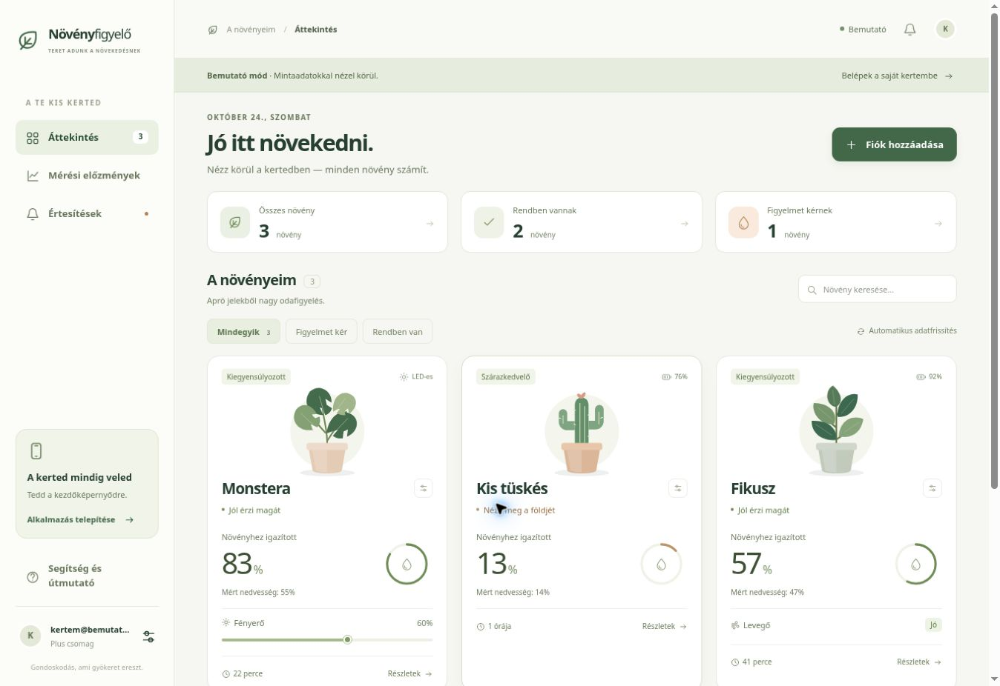
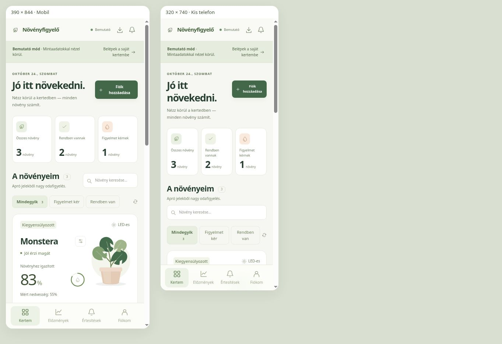

# Ellenőrzési jegyzőkönyv — 2026-10-24

## Automatizált ellenőrzés

`npm run check`, `npm test`, `npm run build`: sikeres. **19 teszt**, 0 hiba.

A tesztek a kategóriaszámítást, a hiányzó/hibás adatokat, a mérési idők kezelését, a lejáró előfizetést, az előzmények deduplikálását, az állapotszűrést, az auth-visszaállítás sorrendjét, a többfiókos adatkapcsolatok elkülönítését, a kijelentkezéskori takarítást, az offline írások tiltását és a service worker határait ellenőrzik. A Firebase adapter tesztjei helyi SDK-helyettesítést használnak, nem az éles adatbázist.

## Böngészőben ellenőrzött folyamatok

- A belépőoldal és a bemutató kert megnyitása.
- Növénynév szerkesztése, mentési visszajelzés és a frissült név megjelenése.
- Keresés: a „tüskés” keresés csak a hozzá tartozó kártyát jeleníti meg.
- Részletes grafikon megnyitása, valós adattípusú, egyértelműen mintaadatként jelzett bemutató pontok.
- Emailbeállítás: cím nélküli új bekapcsolás hibát ad; érvényes beállítás után az ablak bezár és látható mentési üzenet jelenik meg.
- LED-csúszka billentyűzetes állítása 60%-ról 100%-ra és az új érték visszajelzése.
- Mobilos elrendezés 390×844 és 320×740 méretű böngészőkeretben, vízszintes túllógás nélkül. Ez elrendezési próba, nem fizikai iPhone/Android-eszközteszt.

## A vizsgálatkor fennmaradó hozzáférési korlátok

- A Netlify kezelőfelülete bejelentkezést kér.
- A Firebase konzolhoz az elérhető böngészőfióknak nincs projektjogosultsága.
- Az éles bejelentkezés, valódi ESP32-LED, éles mérésfogadás, a szerveres email-időzítők, a fizetés utáni szinkron és a valódi telefonos push kézbesítés nem lett végponttól végpontig igazolva.
- A PWA statikus állományai és workerlogikája ellenőrzöttek; a fizikai telefonos telepítés és az éles HTTPS-en történő frissítés/offline ciklus az élesítés utáni ellenőrzés része.

A bemutató tesztelése nem küldött emailt, push-t, és nem módosította az éles eszközöket.
